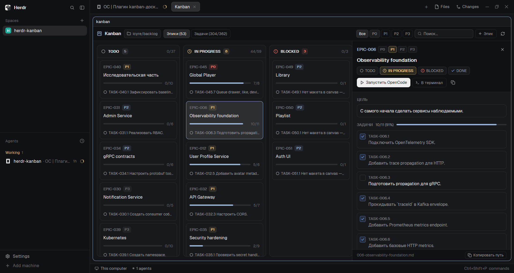

# herdr-kanban

Kanban-доска для [Herdr](https://herdr.dev), которая читает и редактирует Markdown-бэклог проекта (`backlog/*.md`) прямо во вкладке, сплите или оверлее.



## Возможности

- **Два режима доски:**
  - **Эпики** — карточки эпиков по колонкам `TODO`, `IN PROGRESS`, `BLOCKED`, `DONE` с приоритетом (`P0`–`P3`), прогресс-баром и следующей незавершённой задачей.
  - **Задачи** — плоская доска по всем `TASK-*` из всех эпиков с привязкой к родительскому эпику и пагинацией длинных колонок.
- **Автопоиск и выбор папки:** автоматически находит `backlog/`, `docs/backlog/` или `.backlog/` в активном `space` (включая корень git-репозитория), запоминает выбор для каждого `space` и недавние папки, позволяет выбрать папку вручную через системный диалог.
- **Редактирование `.md` на месте:**
  - перетаскивание карточек между колонками, кнопки быстрого переноса и контекстное меню по правому клику;
  - панель деталей эпика: смена статуса и приоритета, рендер секций `Цель`, `Definition of Done`, `Итог реализации`, переключение чекбоксов задач (`[ ]`, `[-]`, `[!]`, `[x]`), добавление новых задач и создание новых эпиков;
  - безопасная запись через `writeTextFile` с проверкой исходного содержимого (не затирает правки, сделанные агентом на диске) и сохранением `CRLF`/`LF`.
- **Запуск агентов по эпику или задаче:**
  - кнопка запуска открывает новую вкладку с выбранным агентом (`knownAgents`) в корне проекта и передаёт структурированный промпт;
  - отправка промпта в живой терминал активного `space` (`hc send`) или копирование в буфер обмена.
- **Живое обновление:** отслеживает изменения в локальной папке через `watchFolder` + резервный опрос раз в 10 секунд.

## Установка

Клонируйте репозиторий:

```sh
git clone https://github.com/tehrelt/herdr-kanban.git
```

### Windows (PowerShell / cmd)

Создайте junction-ссылку из папки модов Herdr на `mods\kanban`:

```cmd
mklink /J "%USERPROFILE%\.config\herdr-app\mods\kanban" "<path-to-repo>\herdr-kanban\mods\kanban"
```

### macOS / Linux

```sh
ln -s /path/to/herdr-kanban/mods/kanban ~/.config/herdr-app/mods/kanban
```

## Открытие в Herdr

Через CLI:

```sh
# Новая вкладка
herdr-app do tab.new --name Kanban --mod kanban

# Сплит справа от текущего терминала
herdr-app do pane.split --direction right --mod kanban

# С явной папкой бэклога
herdr-app do tab.new --name Kanban --mod kanban --props '{"folder":"/path/to/project/backlog"}'

# Оверлей
herdr-app do mod.open --name kanban
```

### Горячие клавиши (опционально)

В файле [`keys.json`](keys.json) приведены рекомендуемые биндинги для `~/.config/herdr-app/keys.json`:

- `alt-b` — открыть Kanban в новой вкладке
- `alt-shift-b` — открыть Kanban сплитом справа

Внутри сфокусированной доски работают клавиши:

- `1` / `2` — переключение `Эпики` / `Задачи`
- `/` — фокус в поиск
- `n` — создать новый эпик
- `r` — обновить доску
- `Esc` — закрыть контекстное меню / панель деталей / оверлей

## Формат Markdown

Поддерживаются файлы вида `001-bootstrap.md` (служебные `README.md`, `CURRENT.md`, `CHANGELOG.md`, `AGENTS.md` пропускаются):

```markdown
# EPIC-006 — Observability foundation

**Status:** [-] IN PROGRESS

**Priority:** P1

## Цель

Краткое описание цели эпика.

## Задачи

- [x] TASK-006.1 Подключить OpenTelemetry SDK.
- [ ] TASK-006.2 Подготовить propagation для gRPC.
```

Если строка `**Status:**` отсутствует, статус эпика выводится автоматически по статусам его задач (`[!]`, `[-]`, смесь `[x]`/`[ ]`, все `[x]`).

## MCP-сервер для задач

В репозитории есть stdio MCP-сервер (`mcp/index.js`) на базе Bun и `@modelcontextprotocol/sdk`, который работает с теми же Markdown-файлами бэклога через `mods/kanban/parser.js`.

### Установка зависимостей

```sh
bun install
```

### Подключение в Claude Code / `.mcp.json`

```json
{
  "mcpServers": {
    "herdr-kanban": {
      "command": "bun",
      "args": ["run", "<path-to-repo>/herdr-kanban/mcp/index.js"]
    }
  }
}
```

Папка бэклога определяется автоматически из `cwd` (`backlog/`, `docs/backlog/`, `.backlog/` или корень git-репозитория). При необходимости её можно зафиксировать через `--dir /path/to/backlog`, переменную окружения `HERDR_KANBAN_DIR` или параметр `backlogDir` в каждом вызове инструмента.

### Доступные инструменты

- `kanban_board_summary` — сводка по эпикам и задачам (статусы, приоритеты, заблокированные и активные эпики).
- `kanban_list_epics` — список эпиков с фильтрами `status`, `priority`, `query`.
- `kanban_get_epic` — полная карточка эпика (`goal`, `dod`, `summary`, `tasks`) по ID, номеру или имени файла.
- `kanban_list_tasks` — список задач с фильтрами `epic`, `status`, `priority`, `query` и пагинацией (`limit`, `offset`).
- `kanban_create_epic` — создание нового нумерованного `.md`-эпика.
- `kanban_update_epic` — изменение статуса и/или приоритета эпика.
- `kanban_add_task` — добавление задачи с автогенерацией `TASK-NNN.K` и синхронизацией статуса эпика.
- `kanban_update_task` — смена статуса задачи (`todo`, `in_progress`, `blocked`, `done`) с автосинхронизацией эпика.
- `kanban_build_prompt` — генерация структурированного промпта для агента по эпику или задаче.

## Проверка и тесты

```sh
bun test
herdr-app check ~/.config/herdr-app/mods/kanban
```
