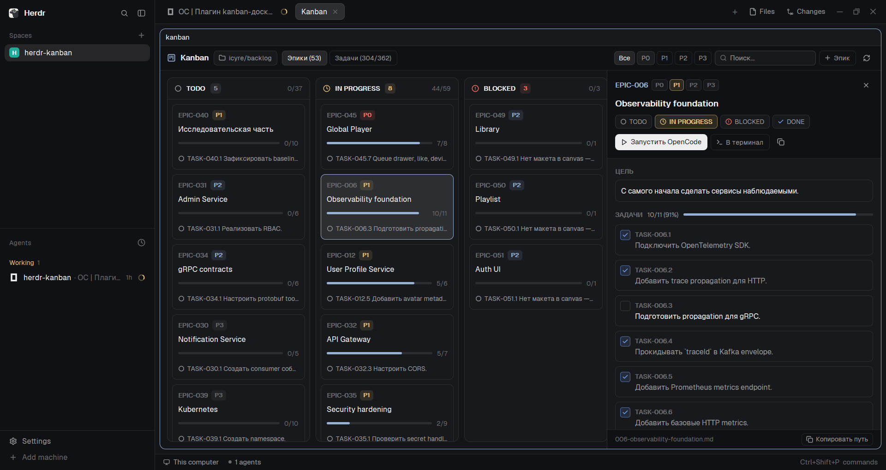

# Kanban

A project backlog Kanban board mod for Herdr that reads Markdown epic files (`backlog/*.md`), displays epics or individual tasks across four status columns (`TODO`, `IN PROGRESS`, `BLOCKED`, `DONE`), edits statuses and tasks back to disk safely, and launches coding agents directly on an epic or task.

## What you see

- **Top toolbar (`chrome` background, `border` bottom divider):**
  - Mod icon (`mods/kanban/icons/kanban.svg`) and `Kanban` title.
  - Folder selector pill showing the active backlog folder (`<parent>/<dir>` or `Выбрать папку…`), plus a `Только чтение` badge on remote SSH spaces.
  - Mode switcher pills: `Эпики (N)` and `Задачи (done/total)`.
  - Priority filter pills (`Все`, `P0`, `P1`, `P2`, `P3`), search input (`Поиск…`), `+ Эпик` button, and refresh icon button.
- **Four Kanban columns (`surface` cards on `canvas` background, `min_w: 248` each with horizontal scroll when narrow and independent vertical scrollbars):**
  - `TODO` (`[ ]`), `IN PROGRESS` (`[-]`), `BLOCKED` (`[!]`), `DONE` (`[x]`), each with status icon, count badge, and task completion ratio.
  - **Epic cards:** `EPIC-NNN` ID, priority badge (`P0`–`P3`), title, progress bar (`done/total`), blocked task count badge (`!N`), and the next open task preview. Hovering reveals quick move arrows (`←` / `→`) and a `▶` agent launch button.
  - **Task cards:** `TASK-NNN.K` ID, parent `EPIC-NNN` badge, priority badge, task title, subitem count, and hover quick actions (`✓`, `←`, `→`, `▶`). Long columns paginate in batches of 50 (`Показать ещё`).
- **Right detail drawer (`340–480px` wide, or full width below `760px`):**
  - Epic ID, clickable `P0`–`P3` priority pills, title, clickable status pills (`TODO`, `IN PROGRESS`, `BLOCKED`, `DONE`), primary `Запустить <Agent>` button with agent selector, `В терминал` button (when a live terminal exists in the space), and copy-prompt button.
  - Markdown-rendered `ЦЕЛЬ`, interactive `ЗАДАЧИ` checklist (checkbox toggle, `[-]` / `[!]` / `▶` hover actions, nested subitems, inline `+ Добавить` task input), `DEFINITION OF DONE`, `ИТОГ РЕАЛИЗАЦИИ`, and footer with filename and `Копировать путь`.
- **Empty / loading states:** centered card with `Выбрать папку…`, `+ Создать первый эпик` (when folder is empty), and clickable recent folders list.

## How it behaves

- **Folder resolution:** checks `props().folder`, saved per-space folder in `shared("kanban.folders")`, then auto-detects `backlog/`, `docs/backlog/`, `.backlog/` in the active space's terminal `cwd` or git top-level (`git rev-parse --show-toplevel`).
- **Markdown parsing & safe writes:** ignores `README.md`, `CURRENT.md`, `CHANGELOG.md`, `AGENTS.md`. Infers epic status from tasks when `**Status:**` is omitted. Preserves `CRLF`/`LF` line endings and uses `writeTextFile(path, next, expected)` so external edits by agents are never overwritten.
- **Interactions:** drag cards between columns (`on_mouse_down` + `on_hover` + `on_mouse_up`), right-click cards for a context menu (move column, launch agent, send to terminal via `hc send`, copy prompt, copy path), or use keyboard shortcuts (`1`/`2` mode, `/` search, `n` new epic, `r` refresh, `Esc` close menu/detail/overlay).
- **Live updates:** watches local backlog folders with `watchFolder` plus a 10-second fallback timer.

## Built from

- **Mod files (`mods/kanban/`):** `mod.json` (`place: "none"`, `focusable: true`, dialog overlay fallback), `main.js` (`Kanban` view), `parser.js` (pure Markdown parser/serializer), `board.js` (toolbar, columns, cards, context menu, empty/loading states), `detail.js` (epic detail drawer), `ui.js` (theme helpers and buttons), and 18 monochrome SVGs in `mods/kanban/icons/`.
- **Herdr APIs:** `spaces`, `panes`, `focused`, `agents`, `terminals`, `exec`, `hc`, `readTextFile`, `writeTextFile`, `watchFolder`, `pickFolder`, `knownAgents`, `run`, `closeOverlay`, `notify`, `theme`, `props`, `nextCommand`, `checking`, `window`, `shared`, `setShared`, `settings`.
- **Commands called:** `tab.new` (launch agent with `argv` and `task` prompt), `pane.focus` (focus terminal after `hc send`).
- **External programs:** `powershell` (Windows) or `sh` (Unix) to list `*.md` files, `git rev-parse --show-toplevel` to locate repo root, `where.exe`/`which` fallback for agent detection.

## Watch out

- `on_size_change` and `local_position` report zoomed logical pixels while layout builders multiply by `settings().zoom`; divide both by `zoom` so narrow-mode breakpoints and context menu coordinates stay accurate at any zoom.
- `writeTextFile` only works on the local machine; remote SSH spaces (`space.machine !== null`) automatically switch to read-only mode.
- `overflow_y_scroll()` inside columns needs an `.absolute().inset_0()` wrapper inside a `.flex_1().min_h(0).relative()` container so GPUI constrains column height and scrolls properly.

## Done when

- `bun test` passes all parser and real-backlog compatibility tests.
- `herdr-app check ~/.config/herdr-app/mods/kanban` passes with zero errors.
- Opening Kanban in a tab (`tab.new --mod kanban`) or split (`pane.split --mod kanban`) renders all columns, switches between `Эпики` and `Задачи`, opens the detail drawer, updates `.md` files on status/task changes, and launches an agent tab with the task prompt.
